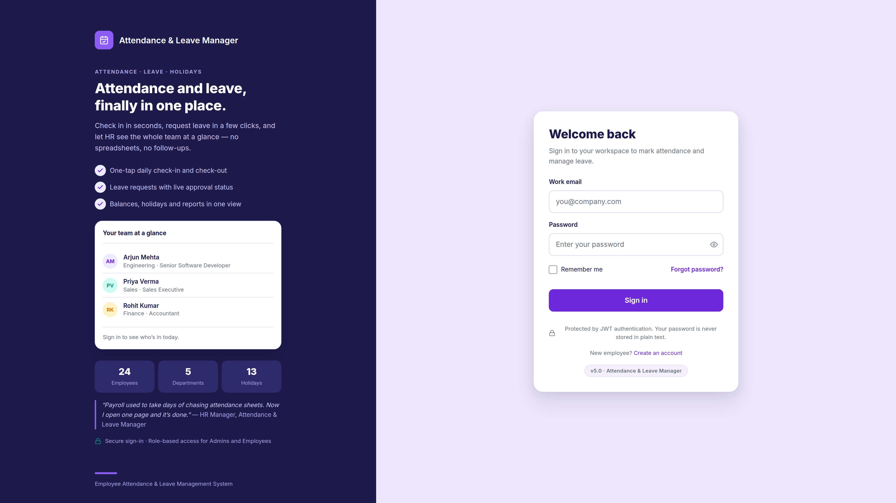
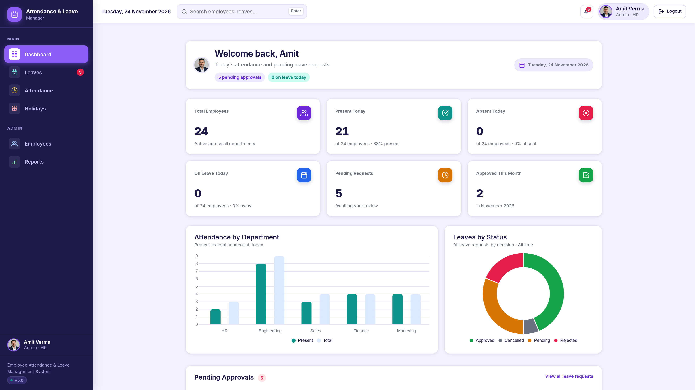
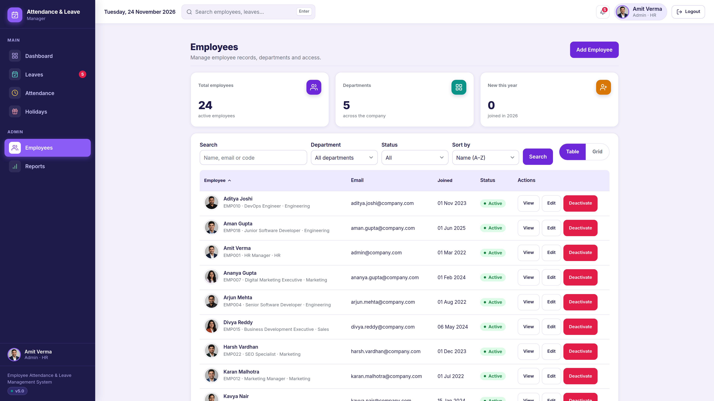
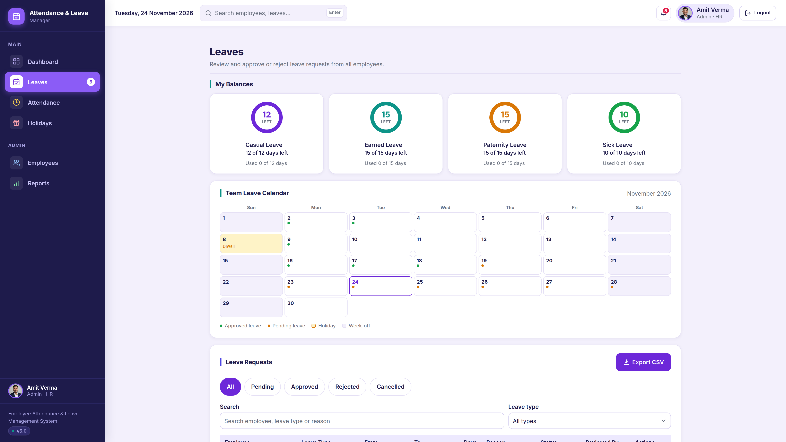
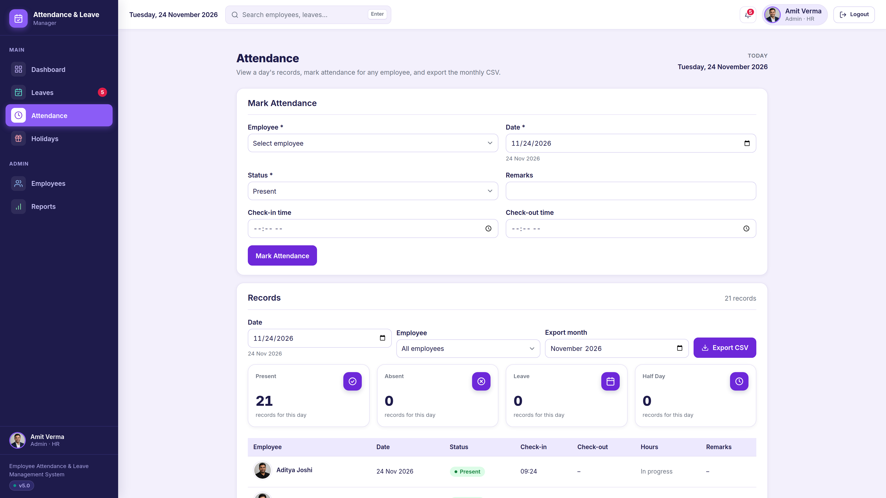
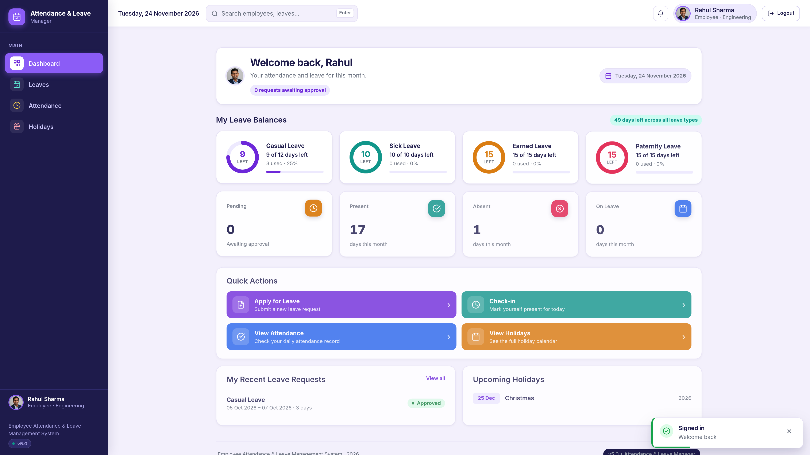
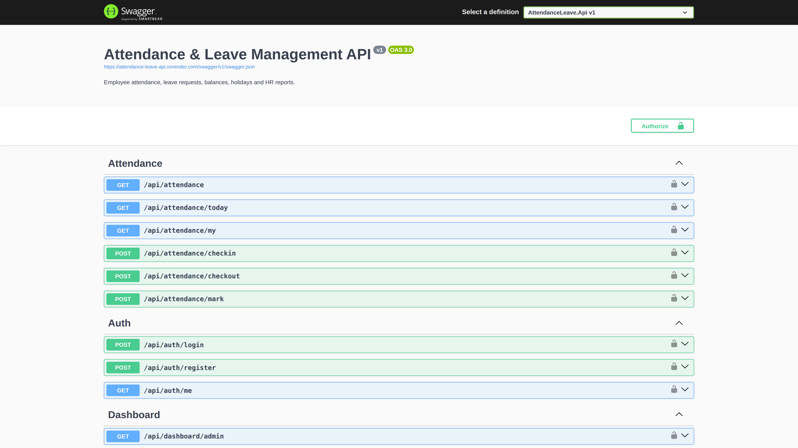

# Employee Attendance and Leave Management System

AttendFlow — a full-stack .NET HR platform for managing employee attendance and leave.

- **Live website:** https://employee-attendance-leave-managemen-tau.vercel.app
- **Live API:** https://attendance-leave-api.onrender.com/api/health
- **Repository:** https://github.com/Vikashsingh03/Employee-Attendance-Leave-Management

## Table of Contents

- [Project Overview](#project-overview)
- [Key Features](#key-features)
- [Technology Stack](#technology-stack)
- [Project Architecture](#project-architecture)
- [Folder Structure](#folder-structure)
- [Prerequisites](#prerequisites)
- [Installation and Setup](#installation-and-setup)
- [Application URLs](#application-urls)
- [API Documentation](#api-documentation)
- [Demo Accounts](#demo-accounts)
- [Testing](#testing)
- [Build Commands](#build-commands)
- [Screenshots](#screenshots)
- [Known Limits](#known-limits)
- [Possible Future Enhancements](#possible-future-enhancements)
- [Author and Project Information](#author-and-project-information)

## Project Overview

The Employee Attendance and Leave Management System is a full-stack web application for companies that still manage attendance and leave on paper, in spreadsheets, or over chat. Those ways lose records, cause errors, and give managers no live view of who is present, who is on leave, and which leave requests are waiting.

This project puts all of it in one place. Employees check in and check out, apply for leave, and see their own leave balance and attendance history. Admins see live dashboard statistics, manage employees, approve or reject leave requests, and manage holidays. Access is split by role: an employee can only see and change their own data, while an admin manages the whole company.

The application is deployed and working: the Angular frontend runs on Vercel, the ASP.NET Core API runs on Render, and the source code is in this repository. The same code also runs locally for development.

## Key Features

### Authentication and authorization

- Employee signup and login through the ASP.NET Core Web API (`POST /api/auth/register`, `POST /api/auth/login`).
- JWT Bearer authentication for protected API requests.
- BCrypt password hashing.
- Two application roles:
  - `Admin`
  - `Employee`
- Role-protected Angular routes (route guards) and backend authorization.
- Signup creates Employee accounts only; the Admin account is seeded.
- JWT tokens expire after 8 hours.

### Attendance

- Employee check-in and check-out from the dashboard.
- Admin attendance view for all employees, with date filtering.
- Employee "My Attendance" history view.
- "Today" view showing who has checked in.
- Attendance records are stored per employee per day.

### Leave management

- Apply for leave with a leave type, dates, and reason.
- Leave requests go to the admin for approval.
- Admin can approve, reject, or cancel requests.
- Approved leave deducts days from the employee's leave balance automatically.
- Leave balances per employee per leave type (Casual, Sick, Earned, and more).
- Leave balance is calculated in calendar days minus Sundays.
- Employee "My Leaves" view with request status.
- Admin leave-request list with pending approvals.

### Dashboards and reports

- Admin dashboard statistics: total employees, present today, absent today, on leave today, pending requests, approved this month.
- Attendance by department chart.
- Leaves by status chart.
- Employee dashboard with today's status and leave balance summary.
- Reports page for attendance and leave data.

### Employee and master data

- Employee list, detail, and search (admin).
- Employee profile photos (seeded images in `web/src/assets/employees/`).
- Departments, leave types, and holidays managed through the API.
- 5 departments, 24 employees, 5 leave types, and 13 holidays (2026) seeded on first run.

### Search, validation, and feedback

- Search, sort, and filter on employee, attendance, and leave lists.
- Server-side validation with clear error messages.
- Toast notifications in the frontend for success and error feedback.
- Centralized error handling in the API.

## Technology Stack

| Area | Technology |
| --- | --- |
| Backend | ASP.NET Core 8 Web API (.NET 8) |
| Frontend | Angular 18 (TypeScript) |
| Data Access | Entity Framework Core 8 |
| Database | SQL Server (target) / SQLite (default and live demo) |
| Authentication | JWT Bearer, BCrypt |
| API Documentation | Swagger / OpenAPI |
| API Hosting | Render |
| Frontend Hosting | Vercel |
| Container | Docker (API) |

## Project Architecture

### api/AttendanceLeave.Api (ASP.NET Core 8 Web API)

- **Controllers/** — 11 controllers: `Attendance`, `Auth`, `Dashboard`, `Departments`, `Employees`, `Health`, `Holidays`, `LeaveBalances`, `LeaveRequests`, `LeaveTypes`, `Reports`.
- **Data/** — `AppDbContext` (EF Core context), `SeedData` (demo data), `AppDates` (date helpers).
- **Services/** — `AuthService` (login, token, password hashing), `EmailService` (leave notifications), `LeaveCalculator` (leave balance and working-day calculation), `TimeSpanConverter`.
- **Models/** — Entity classes for the 7 tables: Department, Employee, LeaveType, LeaveRequest, LeaveBalance, Attendance, Holiday.
- **Dtos/** — Request and response DTOs.
- **Program.cs** — API configuration, database provider selection (SQL Server or SQLite), JWT authentication, CORS, Swagger.

### web/ (Angular 18)

- **features/** — Pages: login, signup, dashboard, attendance, leaves, employees, holidays, reports.
- **core/** — Auth guard, auth interceptor, auth service, data service, models, employee photos, toast service.
- **shared/toasts/** — Toast notification component.
- **environments/** — `environment.ts` (local) and `environment.prod.ts` (live) with the API base URL.

### Deployment

- API: Render web service (`render.yaml` in the repository root), Docker image from `api/Dockerfile`.
- Frontend: Vercel static hosting (`web/vercel.json`).
- The API allows calls from the frontend origin through CORS (`AllowedOrigins` in `appsettings.json`).

## Folder Structure

```text
Employee-Attendance-Leave-Management/
├── .dockerignore
├── .gitignore
├── README.md
├── render.yaml
├── api/
│   ├── AttendanceLeave.sln
│   ├── DATABASE.md
│   ├── Dockerfile
│   └── AttendanceLeave.Api/
│       ├── AttendanceLeave.Api.csproj
│       ├── Program.cs
│       ├── appsettings.json
│       ├── appsettings.Development.json
│       ├── Controllers/
│       │   ├── AttendanceController.cs
│       │   ├── AuthController.cs
│       │   ├── DashboardController.cs
│       │   ├── DepartmentsController.cs
│       │   ├── EmployeesController.cs
│       │   ├── HealthController.cs
│       │   ├── HolidaysController.cs
│       │   ├── LeaveBalancesController.cs
│       │   ├── LeaveRequestsController.cs
│       │   ├── LeaveTypesController.cs
│       │   └── ReportsController.cs
│       ├── Data/
│       │   ├── AppDbContext.cs
│       │   ├── AppDates.cs
│       │   └── SeedData.cs
│       ├── Dtos/
│       │   └── Dtos.cs
│       ├── Models/
│       │   └── Entities.cs
│       ├── Properties/
│       │   └── launchSettings.json
│       └── Services/
│           ├── AuthService.cs
│           ├── EmailService.cs
│           ├── LeaveCalculator.cs
│           └── TimeSpanConverter.cs
├── docs/
│   └── screenshots/
│       ├── login.png
│       ├── admin-dashboard.png
│       ├── employees.png
│       ├── leave-requests.png
│       ├── attendance.png
│       ├── employee-dashboard.png
│       └── swagger.png
└── web/
    ├── .gitignore
    ├── README.md
    ├── angular.json
    ├── package.json
    ├── package-lock.json
    ├── tsconfig.json
    ├── tsconfig.app.json
    ├── vercel.json
    └── src/
        ├── index.html
        ├── main.ts
        ├── styles.css
        ├── app/
        │   ├── app.component.ts
        │   ├── app.component.html
        │   ├── app.component.css
        │   ├── app.routes.ts
        │   ├── core/
        │   │   ├── auth.guard.ts
        │   │   ├── auth.interceptor.ts
        │   │   ├── auth.service.ts
        │   │   ├── data.service.ts
        │   │   ├── employee-photos.ts
        │   │   ├── models.ts
        │   │   └── toast.service.ts
        │   ├── features/
        │   │   ├── attendance/
        │   │   ├── dashboard/
        │   │   ├── employees/
        │   │   ├── holidays/
        │   │   ├── leaves/
        │   │   ├── login/
        │   │   ├── reports/
        │   │   └── signup/
        │   └── shared/
        │       └── toasts/
        ├── assets/
        │   └── employees/
        │       ├── emp001.jpg
        │       ├── ...
        │       └── emp024.jpg
        └── environments/
            ├── environment.ts
            └── environment.prod.ts
```

## Prerequisites

- .NET 8 SDK
- Node.js 20 LTS (or later)
- Git
- SQL Server instance — only if you want to run on SQL Server instead of the default SQLite (see the setup section).

## Installation and Setup

### 1. Clone the repository

```bash
git clone https://github.com/Vikashsingh03/Employee-Attendance-Leave-Management.git
cd Employee-Attendance-Leave-Management
```

### 2. Configure the backend (optional)

The API runs on SQLite by default (`DatabaseProvider` is set to `Sqlite` in `api/AttendanceLeave.Api/appsettings.json`). The SQLite file `attendance.db` is created automatically, and demo data is seeded on the first run. No database server setup is needed for local development.

To run on SQL Server instead:

1. Set `DatabaseProvider` to `SqlServer` in `appsettings.json` (or through the `DatabaseProvider` environment variable).
2. Set the `ConnectionStrings:SqlServer` value to your SQL Server instance. The default in the repository is `Server=localhost;Database=AttendanceLeaveDB;Trusted_Connection=True;TrustServerCertificate=True`.
3. See `api/DATABASE.md` for the full switch notes.

For production, set a long random JWT signing key through the `Jwt__Key` environment variable. The repository ships a development-only key for local testing — do not use it in production.

Email is disabled by default (`Email:SmtpHost` is empty). When it is empty, the API logs a warning and continues; it never pretends an email was sent. To enable leave approve/reject notifications, set the SMTP settings in `appsettings.Development.json` (not committed) or through environment variables.

### 3. Restore dependencies

```bash
dotnet restore api/AttendanceLeave.sln
```

### 4. Run the API

```bash
dotnet run --project api/AttendanceLeave.Api
```

The API starts at `http://localhost:5000` and Swagger UI is available at `http://localhost:5000/swagger`.

### 5. Run the frontend

```bash
cd web
npm install
npm start
```

The Angular development server runs at `http://localhost:4200` and calls the API at `http://localhost:5000` (see `web/src/environments/environment.ts`).

## Application URLs

| Application | URL |
| --- | --- |
| Live website | https://employee-attendance-leave-managemen-tau.vercel.app |
| Live API | https://attendance-leave-api.onrender.com |
| Live API health check | https://attendance-leave-api.onrender.com/api/health |
| Live Swagger UI | https://attendance-leave-api.onrender.com/swagger |
| Repository | https://github.com/Vikashsingh03/Employee-Attendance-Leave-Management |
| Local website | http://localhost:4200 |
| Local API | http://localhost:5000 |
| Local Swagger UI | http://localhost:5000/swagger |

The live API runs on the Render free tier, so the first request after a period of inactivity can take about a minute while the service wakes up. Open the live site two minutes before a demo.

## API Documentation

The API documentation is available as Swagger UI:

- Local: `http://localhost:5000/swagger`
- Live: `https://attendance-leave-api.onrender.com/swagger`

The API has 11 controllers and 43 endpoints (30 paths) covering authentication, employees, attendance, leave requests, leave balances, departments, leave types, holidays, dashboard statistics, reports, and health.

To call a protected endpoint from Swagger:

1. Call `POST /api/auth/login` with a demo account from the table below.
2. Copy the JWT token from the response.
3. Click the **Authorize** button in Swagger UI and enter `Bearer <token>`.

The health endpoint needs no login:

```bash
curl https://attendance-leave-api.onrender.com/api/health
```

It returns `{"status":"ok","provider":"Sqlite","employees":24}` when the live API is up.

## Demo Accounts

The API seeds demo data on first run, including these accounts:

| Role | Email | Password |
| --- | --- | --- |
| Admin | admin@company.com | Admin@123 |
| Employee | rahul.sharma@company.com | Emp@123 |

There are 24 seeded employees across 5 departments. Demo accounts are for trying the application only — change the passwords before any real use.

## Testing

This repository does not include an automated test suite. Verify the application manually:

1. Health check — `GET /api/health` returns `ok` with the employee count.
2. Swagger — the Swagger UI lists all 43 endpoints.
3. Login — sign in with both demo accounts and confirm the Admin and Employee dashboards load.
4. Attendance — as the employee, check in and confirm the record appears in the admin attendance view.
5. Leave — as the employee, apply for leave; as the admin, approve it and confirm the balance is reduced.

## Build Commands

Build the API in release mode:

```bash
dotnet build api/AttendanceLeave.sln --configuration Release
```

Build the Angular frontend for production:

```bash
cd web
npm run build
```

The production output is generated under `web/dist/`.

To run the API in a Docker container:

```bash
docker build -t attendance-leave-api -f api/Dockerfile api
docker run -p 5000:8080 attendance-leave-api
```

## Screenshots

All screenshots are real captures from the live deployment, taken on 24 November 2026.

### Login Page



### Admin Dashboard



### Employees



### Leave Requests (Admin)



### Attendance (Admin)



### Employee Dashboard



### Swagger UI



## Known Limits

- The live deployment runs on SQLite (Render free tier). SQL Server is the code target for the database — switching is a configuration change only (see `api/DATABASE.md`), but the live deployment has not been run against SQL Server.
- Email notifications are implemented but a real SMTP send has never been tested. With `SmtpHost` empty, email is disabled and the API logs a warning instead.
- Departments and leave types are managed through the API only; they have no pages in the frontend.
- The dashboard shows 0 present on Sundays because the seed data has no attendance rows for Sundays. Check in on the demo day and the number updates.

## Possible Future Enhancements

These are ideas for later work. None of them are built yet.

- Real SMTP email notifications for leave approval and rejection.
- Live deployment on SQL Server.
- Automated test suite for the API and the frontend.
- Manager role between Admin and Employee.
- Leave calendar view.
- Export of attendance and leave reports (CSV / PDF).
- Employee self-service profile editing.

## Author and Project Information

- **Author:** Vikash Kumar Singh
- **Course:** B.Tech, Computer Science and Engineering, AKGEC Ghaziabad
- **Project:** Capstone project, HCLTech .NET Full Stack (Batch-68)
- **GitHub:** https://github.com/Vikashsingh03
